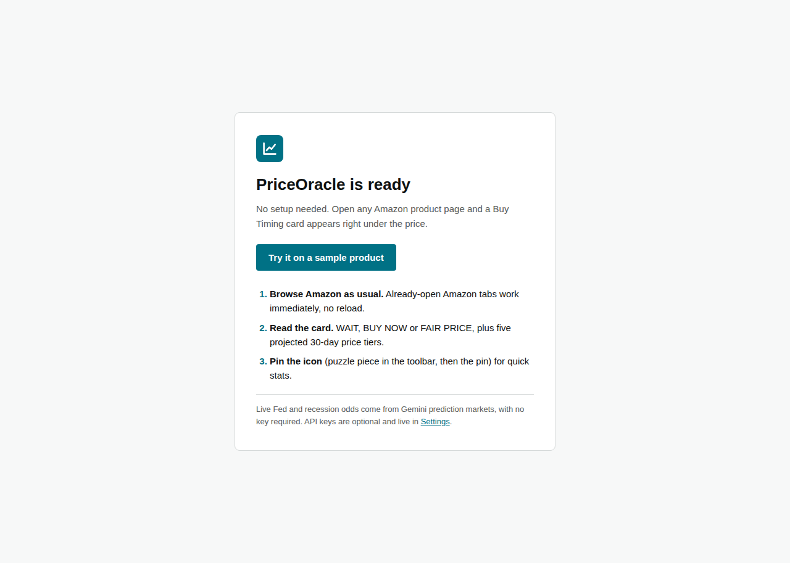
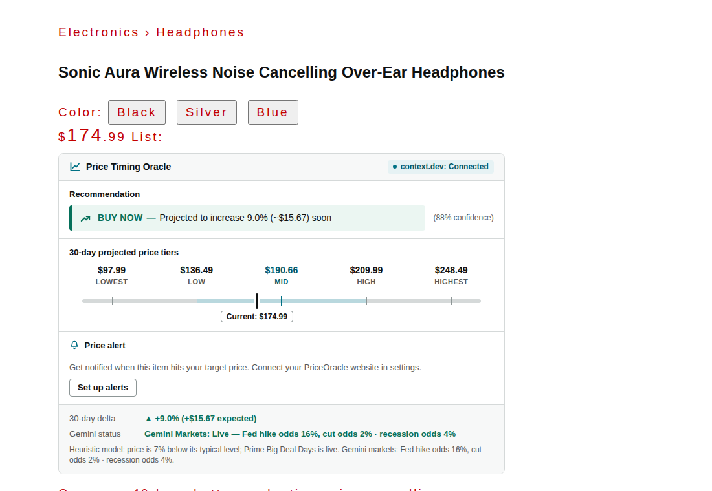
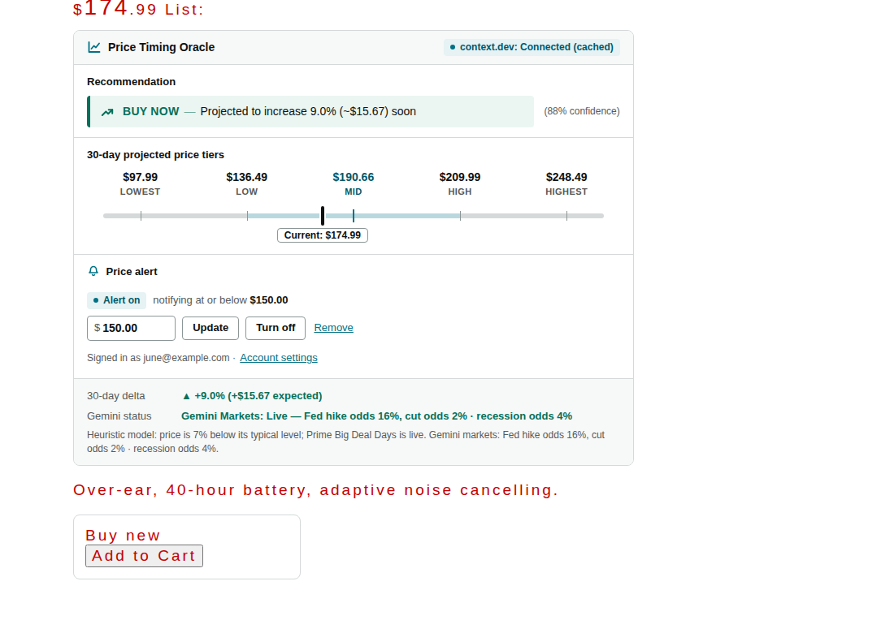
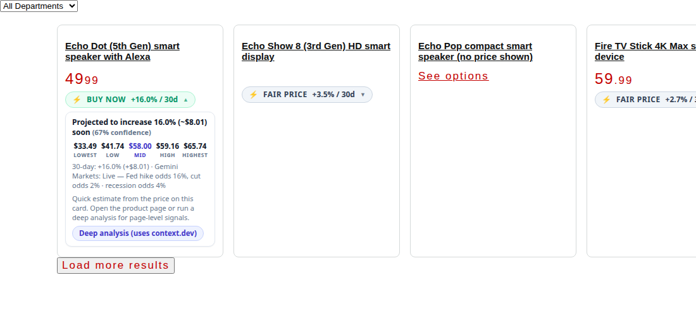
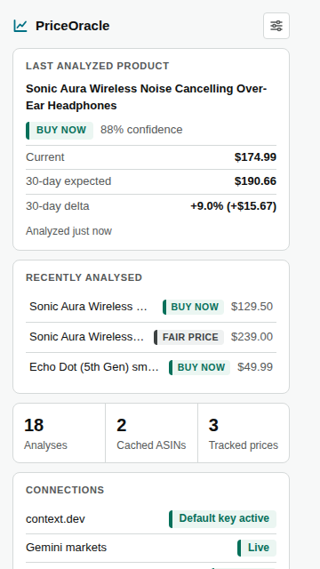
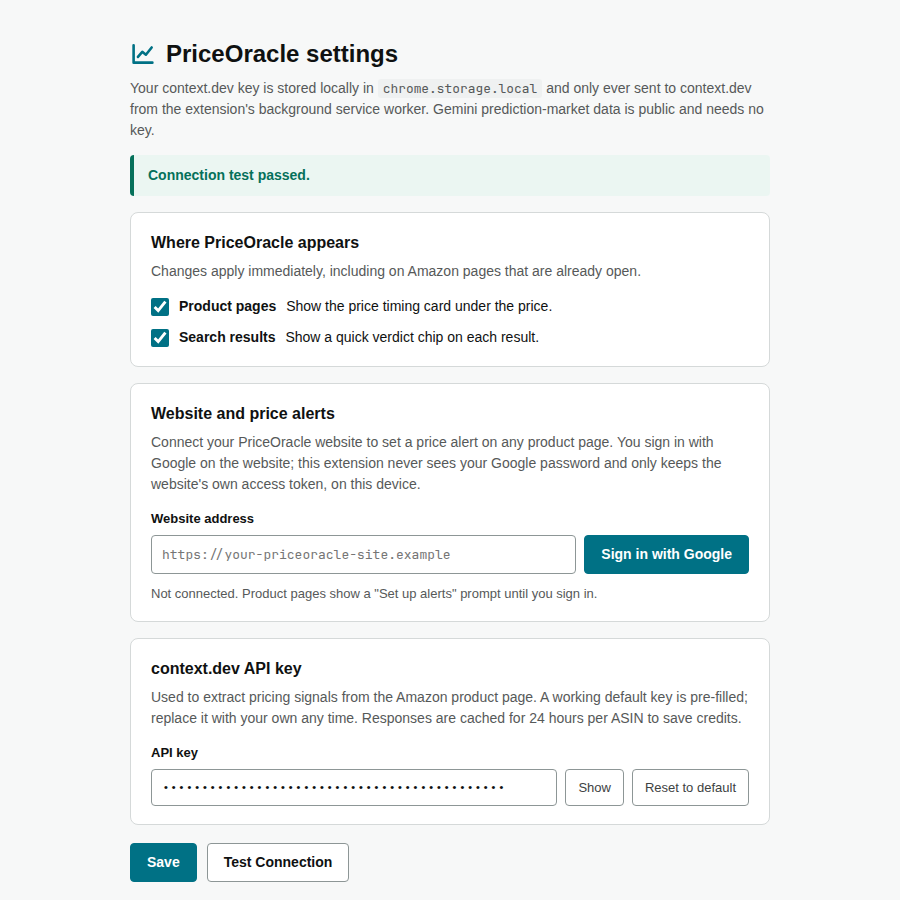

# PriceOracle user guide

PriceOracle adds a small card under the price on Amazon product pages, and a small chip on every search result, that tells you whether to **buy now or wait**. This guide shows how to install it in your own Chrome, use it, and remove it. You don't need an account or an API key, and you don't need to know how to code.

Works in Google Chrome on Windows, macOS, Linux and ChromeOS, and in other Chromium browsers (Microsoft Edge, Brave, Opera, Vivaldi). It does not work on phones or in Safari and Firefox.

## 1. Install

You install it "unpacked" from a downloaded folder. This takes about a minute.

### Step 1: Download

Download the zip file:

- **Latest release:** <https://github.com/JuneKim0712/babab/releases/latest/download/PriceOracle.zip>
- If that link shows "not found", use the version link: <https://github.com/JuneKim0712/babab/raw/v1.0.0/PriceOracle.zip>

### Step 2: Unzip it to a permanent place

Chrome reads the extension from this folder every time it starts, so don't leave it in Downloads or delete it afterwards.

- **Windows:** right-click `PriceOracle.zip`, choose **Extract All...**, and pick a folder such as `Documents\PriceOracle`.
- **macOS:** double-click the zip, then move the new `PriceOracle` folder to `Documents` (or anywhere you won't delete it).
- **Linux:** `unzip PriceOracle.zip -d ~/PriceOracle`

Open the folder. You should see `manifest.json`, an `icons` folder and a `src` folder. If you only see another folder inside, open that one; it's the folder that contains `manifest.json` that you need.

### Step 3: Turn on Developer mode

1. In Chrome, type `chrome://extensions` in the address bar and press Enter. (In Edge use `edge://extensions`, in Brave `brave://extensions`.)
2. Switch on **Developer mode**, the toggle in the top-right corner of that page.

### Step 4: Load the extension

1. Click **Load unpacked** (top left, it appears after Developer mode is on).
2. Select the folder that contains `manifest.json`, then click **Select Folder** (Windows/Linux) or **Open** (macOS).

PriceOracle now appears in your list of extensions, and a **welcome tab** opens.

### Step 5 (optional): Pin the icon

Click the puzzle-piece icon in the Chrome toolbar and click the pin next to PriceOracle. The lightning-bolt icon then stays visible and opens the quick-stats popup.

## 2. Use it

1. Open any Amazon product page at amazon.com, for example <https://www.amazon.com/dp/B09B8V1LZ3>. The welcome tab's **Try it on a sample product** button opens one.
2. The **Price Timing Oracle** card appears right under the price. It takes a second or two the first time, then loads instantly for that product for 24 hours.
3. Pages you already had open when you installed work right away, with no reload.
4. If you pick a different colour or size on the page, the card updates by itself.

The image below uses a made-up product page, so you can see the layout:

### Reading the card

| Part | What it means |
| --- | --- |
| **WAIT** (red) | The price is expected to drop at least 4% over the next 30 days. The card shows the expected percentage and dollar drop. |
| **BUY NOW** (green) | The price is expected to rise at least 4%, so buying today looks better than waiting. |
| **FAIR PRICE** (grey) | No meaningful change expected. Buy if you need it. |
| **% confidence** | How much data backs the call. Higher means more signals were available. It is not a guarantee. |
| **30-day projected price tiers** | Five prices from **Lowest** (a deep sale) to **Highest** (a shortage or peak), with **Mid** as the expected price in 30 days. The black dot marks today's price on that scale. If it sits left of Mid, today's price is on the cheap side. |
| **30-Day Delta** | The expected change in dollars and percent. |
| **context.dev chip** (top right) | Green means product data was fetched. Amber means it couldn't be, and the card is using only what is on the page. |
| **Your price history** | Appears after you have seen a product twice. It shows how many times PriceOracle has seen the product and the lowest and highest price it saw. After a few days of visits this also makes the projection more accurate. |
| **Price alert** | Only if you connected your website (see Settings). Type a target price and click **Set alert**; you are notified by the website when the price reaches it. **Turn off** pauses it, **Remove** deletes it. |
| **Gemini Status** | Green means live Fed-decision and recession odds from Gemini prediction markets were blended in. Amber means they were unreachable and the card used its built-in model alone. |

### Search results

### Good to know

- The projection is an estimate from a model, not a promise. Amazon pages don't publish price history, so treat it as one input to your decision, not financial advice.
- It runs on amazon.com product pages and search results. It does nothing in the cart or on other sites.
- On search results, each product with a visible price gets a chip such as **BUY NOW +3.2% / 30d**. Click the chip to see the five price tiers. Chips are a quick estimate from the price on the card; click **Deep analysis** inside a chip to fetch the product's page data (this is the only search action that uses context.dev). Open the product for the full card.
- A product that is unavailable or has no price shows no card.

## 3. The toolbar popup

Click the PriceOracle icon to see the last product you looked at, how many analyses you have run, how many products are cached, and the status of the data sources. **Clear cache** forces fresh data on the next page view.

## 4. Settings (optional)

You don't need to change anything. To open settings, right-click the PriceOracle icon and choose **Options**, or click the gear in the popup.

- **Where PriceOracle appears:** two switches, **Product pages** and **Search results**. They take effect immediately, even on Amazon tabs that are already open. Turn one off if you only want the other.
- **context.dev API key:** a working key is already filled in. Replace it with your own if you have one. **Reset to default** puts the built-in key back.
- **Website and price alerts:** enter your PriceOracle website address and click **Sign in with Google**. Sign-in happens on the website; the extension only keeps the website's access token on this device. **Sign out** removes it (your alerts stay saved on the website).
- **Local data:** **Clear price history** erases the prices PriceOracle remembered; **Clear context.dev cache** forces fresh product data.
- **Test Connection:** checks that both services are reachable and that your key is accepted, without using any credits.
- Click **Save** to keep changes.

## 5. Update

1. Download the newest `PriceOracle.zip` (same link as above).
2. Unzip it over the old folder (replace the files), or into a new folder.
3. Open `chrome://extensions` and click the circular **reload** arrow on the PriceOracle card. If you used a new folder, remove the old one first and **Load unpacked** the new one.

Then refresh any Amazon tabs that were open. Your settings and cache survive a reload.

## 6. Uninstall

Open `chrome://extensions`, find PriceOracle, click **Remove**, and confirm. You can then delete the folder.

## 7. Privacy

- Everything runs in your browser, including the prices PriceOracle remembers for products you view (up to 300 products, 120 days). **Settings > Clear price history** erases them. There is no PriceOracle server, no analytics and no tracking. The one exception is the optional website link: only if you sign in there, the product, target price and current price of an item you set an alert on are sent to your website.
- When you view a product or click **Deep analysis** on a search chip, the extension sends that product's Amazon link to **context.dev** to read its pricing details, and asks **Gemini's public prediction-market API** for macro odds. Neither request contains anything about you.
- Your context.dev key (the built-in one, or yours if you replace it) stays in your browser's local extension storage.
- Chrome will say the extension can "read and change data on amazon.com". That is required to draw the card on the page. It does not read other sites.

## 8. Troubleshooting

| Problem | What to try |
| --- | --- |
| **I can't find "Load unpacked"** | Turn on **Developer mode** (top right of `chrome://extensions`). |
| **"Manifest file is missing or unreadable"** | You selected the wrong folder. Pick the one that directly contains `manifest.json`, not its parent. |
| **No card appears** | Make sure it is an amazon.com product page (the address contains `/dp/`) or a search results page (`/s?k=...`), and that the item shows a price. Search results without a price ("See options") get no chip. Then reload the extension (`chrome://extensions`, reload arrow) and reload the page. |
| **The card says "Couldn't build a projection"** | Click **Retry**. If it keeps failing, open Settings and run **Test Connection**. |
| **context.dev chip is amber** | The product data service returned an error for this item. The card still works from page data. Hover the chip for the reason. If it says "paused", the key was rejected or its quota is used up: PriceOracle stops calling for 30 minutes. Open Settings and click **Test Connection** (or **Save**) to resume right away. |
| **Gemini chip is amber** | The market-odds service was unreachable. The card falls back to its built-in model. |
| **Chrome asks to disable developer-mode extensions on startup** | Choose to keep PriceOracle. This is a Chrome safety prompt for any extension installed outside the Web Store. |
| **The extension vanished after I moved or deleted the folder** | Chrome reads from the folder. Put the folder somewhere permanent and **Load unpacked** it again. |
| **It works on one Amazon domain but not another** | Only amazon.com is supported (not amazon.co.uk, .de and so on). |
| **Chrome on a work or school computer blocks it** | An administrator may block developer-mode extensions. Use a personal profile or ask your admin. |

Still stuck? Open an issue on the project page: <https://github.com/JuneKim0712/babab/issues>.
